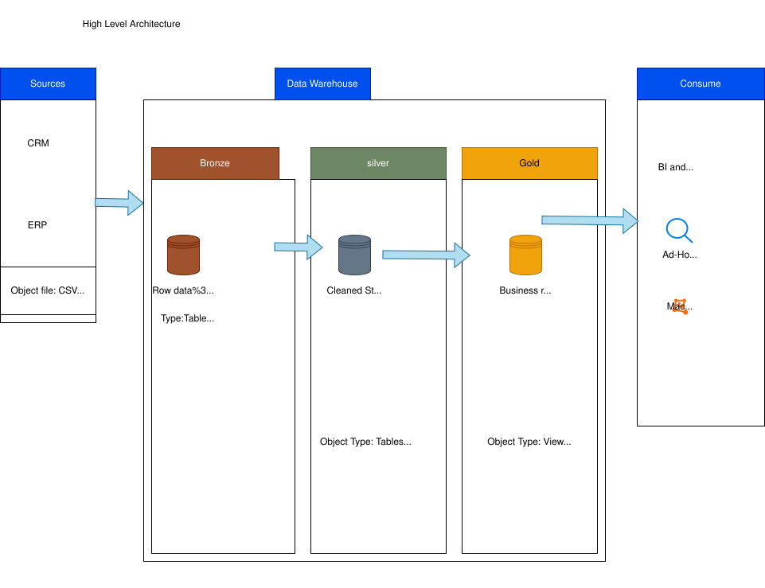
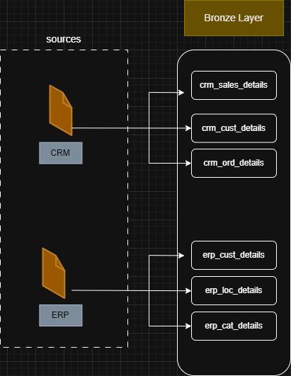
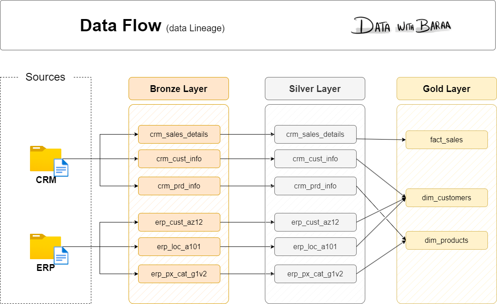
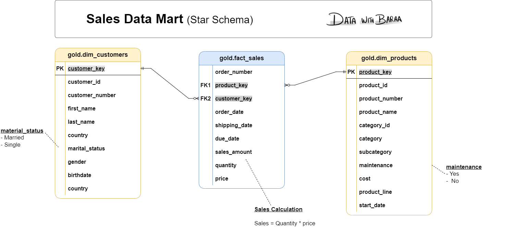

# SQL Data Warehouse Project

## 📌 Project Overview
This project focuses on designing and implementing a **SQL-based Data Warehouse** to support analytical reporting and business intelligence.  
It demonstrates core data warehousing concepts such as **ETL processes, dimensional modeling, fact and dimension tables, and analytical queries**.
## 🏗️ High-Level Data Warehouse Architecture



This diagram represents the **end-to-end architecture of the SQL Data Warehouse**, following a **Bronze–Silver–Gold** layered approach to data processing and analytics.

---

### 🔹 Source Systems
- CRM and ERP systems
- Data extracted as **CSV files**
- Files stored in object storage / folders
- Acts as the raw input layer

---

### 🥉 Bronze Layer (Raw Data)
- Stores **raw, unprocessed data**
- Object type: **Tables**
- Load type:
  - Batch processing
  - Full load (Truncate & Insert)
- No transformations applied
- Purpose: Data archival and traceability


---

### 🥈 Silver Layer (Cleaned & Structured Data)
- Stores **cleaned and structured data**
- Object type: **Tables**
- Load type:
  - Full load (Truncate & Insert)
- Transformations applied:
  - **Data Cleansing**: Trim whitespace, handle NULLs, filter corrupt records
  - **Data Standardization**: Consistent gender (`Male`/`Female`/`n/a`), marital status (`Single`/`Married`/`n/a`), and country names (`Germany`, `United States`)
  - **Data Normalization & Formatting**: Date parsing (e.g., integer to `DATE`), business rule enforcement (`Sales = Quantity * Price`)
  - **Data Enrichment**: Metadata columns (`dwh_create_date`), deriving end dates using `LEAD()`, extracting composite category IDs
- Purpose: Prepare high-quality, validated data for business modeling



#### 🛠️ Silver Layer Implementation
* **DDL Scripts**: [`scripts/silver/ddl_silver.sql`](scripts/silver/ddl_silver.sql) creates the 6 cleaned tables with metadata tracking.
* **Automated ETL**: [`scripts/silver/proc_load_silver.sql`](scripts/silver/proc_load_silver.sql) executes the complete Truncate & Load pipeline with duration tracking and error handling:
  ```sql
  EXEC silver.load_silver;
  ```
* **Data Quality Suite**: [`test/quality_checks_silver.sql`](test/quality_checks_silver.sql) runs comprehensive validation queries (uniqueness, primary key integrity, invalid dates, business rules, whitespace checks).


---

### 🥇 Gold Layer (Business-Ready Data)
- Stores **business-ready datasets** modeled into an analytical **Star Schema**
- Object type: **Views** (virtual layer providing real-time data access)
- Transformations:
  - Multi-system customer data integration (CRM + ERP demographics and location)
  - Active product catalog derivation (`WHERE prd_end_dt IS NULL`) joined with ERP categories
  - Surrogate key mapping (`customer_key`, `product_key`) replacing source natural keys in transactions
  - Business-friendly renaming and consistent casing
- Purpose: Optimized for business intelligence, interactive dashboards, and SQL reporting



#### 🛠️ Gold Layer Implementation
* **DDL Scripts**: [`scripts/gold/ddl_gold.sql`](scripts/gold/ddl_gold.sql) defines the Star Schema analytical views:
  - `gold.dim_customers`: Enriched customer profiles with location and demographics.
  - `gold.dim_products`: Active catalog items linked to categories and maintenance flags.
  - `gold.fact_sales`: Transactional order line items mapped to dimension surrogate keys.
* **Data Catalog**: [`docs/data_catalog.md`](docs/data_catalog.md) provides detailed schema definitions and column descriptions.
* **Data Quality Suite**: [`test/quality_checks_gold.sql`](test/quality_checks_gold.sql) tests surrogate key uniqueness and model referential integrity.

---

### 📊 Data Consumption & Analytics Examples

With the Star Schema in place, analytics queries become straightforward:

#### 1. Total Sales by Product Category
```sql
SELECT 
    p.category,
    SUM(f.sales_amount) AS total_sales,
    SUM(f.quantity)     AS total_units_sold
FROM gold.fact_sales f
JOIN gold.dim_products p ON f.product_key = p.product_key
GROUP BY p.category
ORDER BY total_sales DESC;
```

#### 2. Revenue by Customer Country
```sql
SELECT 
    c.country,
    COUNT(DISTINCT f.order_number) AS total_orders,
    SUM(f.sales_amount)            AS total_revenue
FROM gold.fact_sales f
JOIN gold.dim_customers c ON f.customer_key = c.customer_key
GROUP BY c.country
ORDER BY total_revenue DESC;
```

---

### ⚡ End-to-End Pipeline Execution Guide

1. **Initialize Database & Schemas**:
   ```sql
   -- Run scripts/init_Database.sql
   ```
2. **Build Bronze Layer (Ingest Raw Data)**:
   ```sql
   -- Run scripts/bronze/ddl_trace.SQL
   EXEC bronze.load_bronze;
   ```
3. **Build Silver Layer (Cleanse & Transform)**:
   ```sql
   -- Run scripts/silver/ddl_silver.sql
   EXEC silver.load_silver;
   -- Run test/quality_checks_silver.sql
   ```
4. **Build Gold Layer (Create Star Schema Views)**:
   ```sql
   -- Run scripts/gold/ddl_gold.sql
   -- Run test/quality_checks_gold.sql
   ```

---

### 🎯 Architecture Benefits
- **Clear Separation of Concerns**: Bronze (Raw), Silver (Cleansed), Gold (Curated Star Schema).
- **Scalable & Maintainable**: Modular ETL procedures with built-in execution tracking and error handling.
- **High Analytical Performance**: Star schema dimensional views eliminate complex join logic for BI tools.
- **Enterprise Traceability**: Technical metadata tracking (`dwh_create_date`) and comprehensive data catalogs.

