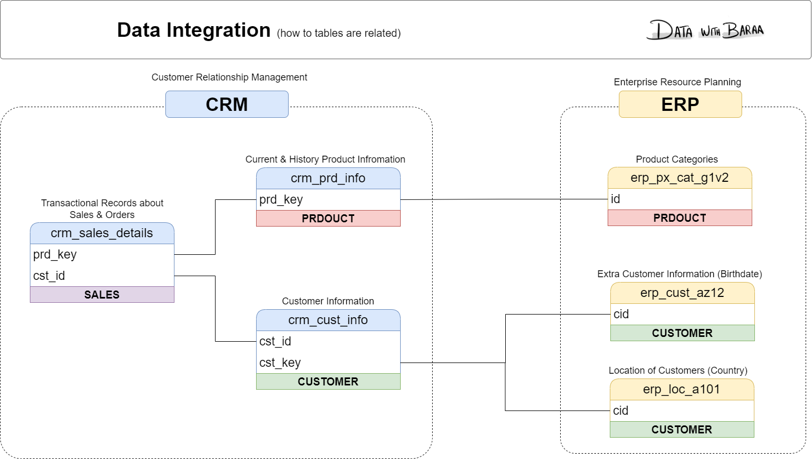

# Data Integration Model & Key Relationships

## Overview
During the initial exploration of the raw Bronze tables, relationships between the CRM and ERP source systems were mapped to establish data connectivity and integration pathways for the Silver and Gold layers.

---

## Source Systems & Tables

### 1. CRM System
* **`bronze.crm_cust_info`**: Master customer records from the CRM.
  - Primary Key: `cst_id`
  - Integration Key: `cst_key` (Business Customer ID, e.g., `AW00011000`)
* **`bronze.crm_prd_info`**: Product catalog and metadata.
  - Primary Key: `prd_id`
  - Integration Key: `prd_key` (Composite code containing Category ID prefix + Product SKU, e.g., `CO-PE-0123`)
* **`bronze.crm_sales_details`**: Sales transaction line items.
  - Foreign Keys: `sls_cust_id` connects to `crm_cust_info.cst_id`, `sls_prd_key` connects to `crm_prd_info.prd_key`

### 2. ERP System
* **`bronze.erp_cust_az12`**: Supplementary customer demographic data (birthdate, gender).
  - Integration Key: `cid` (Contains `'NAS'` prefix, e.g., `NASAW00011000`, requiring transformation to match `crm_cust_info.cst_key`)
* **`bronze.erp_loc_a101`**: Customer geographic data (country).
  - Integration Key: `cid` (Contains hyphens, e.g., `AW-00011000`, requiring hyphen removal to match `crm_cust_info.cst_key`)
* **`bronze.erp_px_cat_g1v2`**: Product categories, subcategories, and maintenance flags.
  - Primary / Integration Key: `id` (e.g., `CO_PE`, matching the extracted 5-character prefix of `crm_prd_info.prd_key`)

---

## Integration Key Mappings

| Source A | Column | Source B | Column | Transformation Required |
| :--- | :--- | :--- | :--- | :--- |
| `crm_cust_info` | `cst_key` | `erp_cust_az12` | `cid` | Strip `'NAS'` prefix from `erp_cust_az12.cid` |
| `crm_cust_info` | `cst_key` | `erp_loc_a101` | `cid` | Remove hyphens `-` from `erp_loc_a101.cid` |
| `crm_prd_info` | `cat_id` | `erp_px_cat_g1v2` | `id` | Extract first 5 characters of `prd_key` and replace `-` with `_` |
| `crm_sales_details` | `sls_cust_id` | `crm_cust_info` | `cst_id` | Direct join on customer numeric ID |
| `crm_sales_details` | `sls_prd_key` | `crm_prd_info` | `prd_key` | Extract product key from composite `prd_key` |
